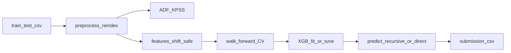

# کیت آماده Time Series برای مسابقه

## فهم مشترک (قفل‌شده)

- **تحویل:** پکیج import‌شدنی + نوت‌بوک نازک نبرد
- **مسئله:** فقط univariate؛ covariate برون‌زا اختیاری؛ `date_col` / `target_col` صریح
- **مدل v1:** فقط XGBoost + FE زمانی (بدون ARIMA/Prophet/PatchTST)
- **استراتژی افق:** `recursive` (پیش‌فرض) و `direct` با سوییچ
- **FE:** lags `[1,7,14]`، rolling mean/std `[7,14]` با `shift(1)`، sin/cos تقویمی؛ `target_diff=True` پیش‌فرض و قابل خاموش شدن
- **داده:** `freq` اجباری در کانفیگ → reindex؛ `y` خالی از train حذف؛ covariate با ffill محدود
- **CV:** walk-forward با `n_splits` / `gap` / `horizon`؛ متریک پیش‌فرض MAE (+ RMSE/RMSLE/MAPE)؛ خطای per-horizon
- **HPO:** defaults قوی در `fit`؛ `tune()` اختیاری و کوتاه
- **دمو:** دیتاست مصنوعی داخل ریپو + نوت‌بوک end-to-end تا submission

## ساختار پیشنهادی

```
data/
  tskit/
    __init__.py
    config.py          # TSConfig dataclass
    stationarity.py    # ADF/KPSS روی raw و differenced
    preprocess.py      # sort, reindex(freq), NaN policy
    features.py        # calendar / lag / rolling (+ leakage-safe shift)
    model.py           # XGBForecaster: fit / predict / tune
    cv.py              # walk-forward + per-horizon metrics
    submit.py          # to_submission(...)
  data/synthetic/
    train.csv
    test.csv
  notebooks/
    battle_notebook.ipynb
  requirements.txt
```

هم‌راستا با شکل سوالات قبلی ([`Questions/`](Questions/)): نوت‌بوک جریان کار را می‌راند؛ منطق تکراری در پکیج می‌ماند.

## جریان روز مسابقه



## قرارداد API (خلاصه)

`TSConfig`: `date_col`, `target_col`, `freq`, `horizon`, `lags`, `rolling_windows`, `target_diff`, `strategy`, `n_splits`, `gap`, `metric`, `exog_cols`.

- `prepare(df, config) -> frame` مرتب‌سازی، reindex، سیاست NaN
- `add_features(frame, config, fit_stats=None)` ساخت FE بدون leakage؛ در infer از تاریخچهٔ train+preds استفاده‌شده
- `XGBForecaster.fit(train, config)` آموزش روی سطح یا تفاضل؛ بازسازی در predict
- `XGBForecaster.predict(history, future_exog|future_index, config)` برای recursive و direct
- `walk_forward_validate(...)` امتیاز کلی + جدول per-horizon
- `to_submission(test_df, preds, path, id_col=None)`

## جزئیات کلیدی پیاده‌سازی

- **Leakage:** تمام lag/rolling فقط از گذشته؛ `shift(1)` روی rolling؛ در recursive، بعد از هر گام پیش‌بینی وارد تاریخچه می‌شود تا lag بعدی ساخته شود.
- **Direct:** یک مدل XGB به‌ازای هر `h` در `1..H` (ساده و قابل‌اطمینان زیر فشار زمان).
- **target_diff:** آموزش روی `y_t - y_{t-1}`؛ در infer جمع تجمعی روی آخرین `y` دیده‌شده.
- **tune():** RandomizedSearch/Optuna سبک روی فضای کوچک (`max_depth`, `learning_rate`, `n_estimators`, `min_child_weight`, `subsample`, `colsample_bytree`) با ارزیابی walk-forward یا آخرین پنجره.
- **Stationarity:** فقط تشخیصی در نوت‌بوک/هلپر — مسیر fit را بلاک نمی‌کند.
- **نوت‌بوک نبرد:** سلول‌های ثابت: load → stationarity → prepare → CV (هر دو strategy) → fit → predict → submission؛ روی [`data/synthetic/`](data/synthetic/) خشک می‌شود.

## وابستگی‌ها

`pandas`, `numpy`, `scikit-learn`, `xgboost`, `statsmodels` (ADF/KPSS)، `optuna` (اختیاری برای `tune`). نسخه‌ها در `requirements.txt` پین می‌شوند تا آفلاین قابل نصب/تکرار باشند.

## خارج از محدوده v1

پنل چندسری، Prophet/ARIMA، PatchTST، تشخیص خودکار نام ستون‌ها.